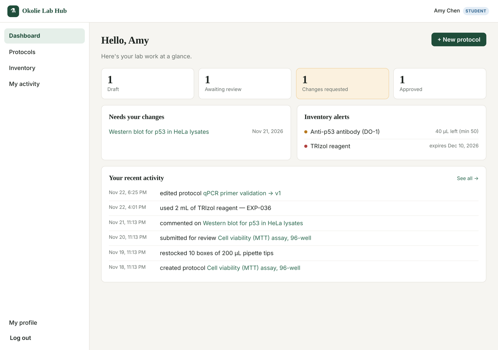
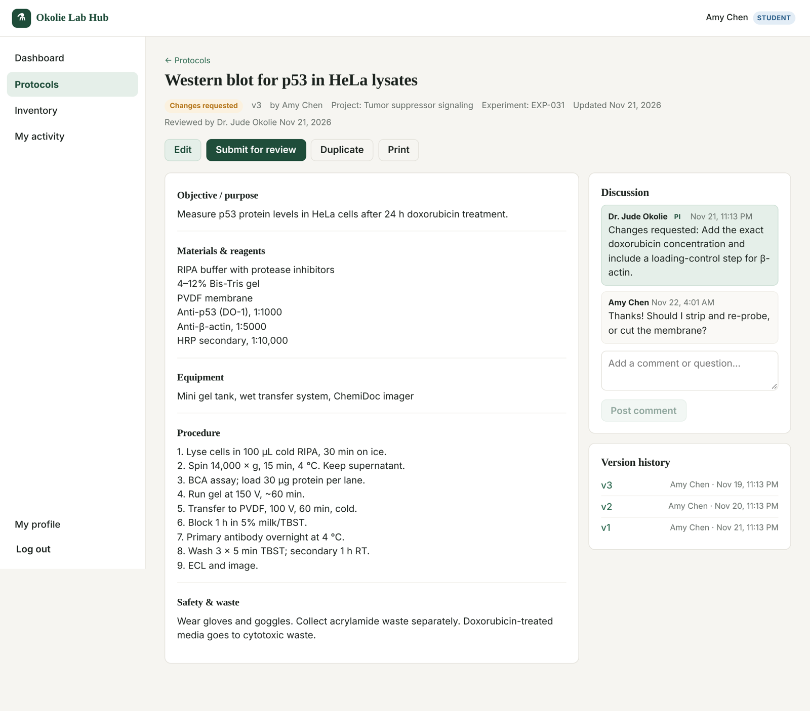
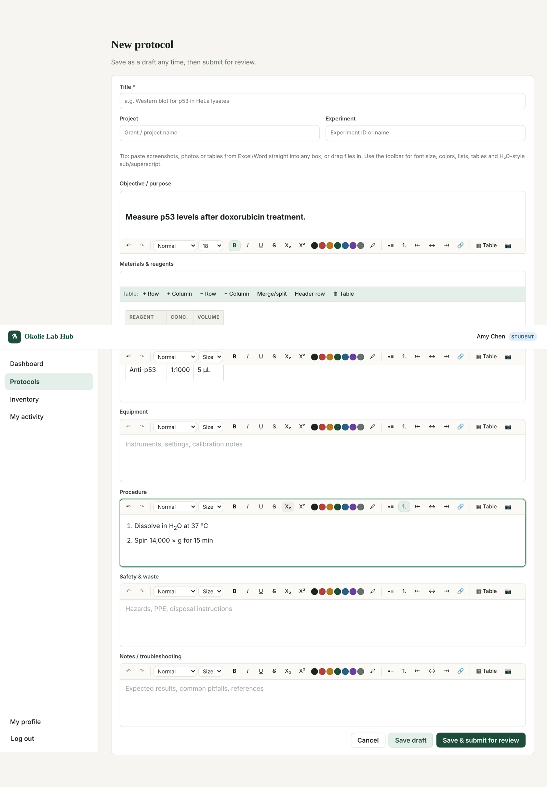
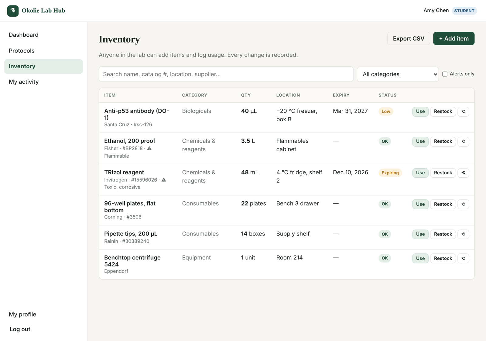

# Research Lab Hub

**An open-source platform for running a research lab:** experimental protocols with PI review, shared lab inventory, automatic activity tracking, and a private tenure & promotion record — with an AI assistant that turns a CV into structured records.

Built for research groups that keep protocols in scattered Word files, track reagents on paper, and rebuild their tenure dossier from memory every year. Each lab deploys its own private copy on [Netlify](https://www.netlify.com/) in a few minutes; no servers to manage.

[](https://app.netlify.com/start/deploy?repository=https://github.com/judebebo32/research-lab-hub)

> Live example: the Okolie Lab runs this at its own invite-only site. Screenshots below use made-up sample data.



## Features

**Protocols with review before publishing**
- Rich editor in every section: paste photos, screenshots and tables straight from Excel/Word, upload videos, font sizes, colors, lists, sub/superscript (H₂O, 10⁶).
- Students write protocols as drafts and submit them; the PI (or a delegated reviewer) approves or requests changes with comments.
- Only approved protocols appear in the lab library. Editing an approved protocol sends it back for review.
- Full version history — every save is kept and viewable side by side.
- Duplicate, print and archive.

**Lab inventory**
- Flexible categories for wet, dry and mixed labs (reagents, biologicals, consumables, equipment, parts, licenses…).
- One-tap *Use* / *Restock* logging with reasons, so every change is traceable.
- Low-stock and expiry alerts on the dashboard; CSV export.

**Activity tracking**
- Every action (protocol written, reviewed, inventory used…) is logged automatically.
- PI view of each member's activity, protocols and last sign-in; CSV export.

**Tenure & promotion record (private to each faculty member)**
- Publications, grants (with funded totals), teaching, mentoring, service, talks, awards, outreach.
- **✨ AI import:** upload a CV (PDF/Word) or paste lists; Claude drafts entries, flags likely duplicates, and nothing is saved until you review it.
- Printable dossier view and CSV export.

**People & access**
- Invite-only accounts (Netlify Identity).
- Owner role for the PI; add co-admins with fine-grained permissions (review protocols, edit protocols, manage inventory, see activity, manage students, own tenure tracker).

**Backups**
- One-click full data download.
- Optional automatic weekly backup to the owner's Google Drive (data + photos/videos), using a Drive scope that can only see the backup folder it creates.

| Protocol review | Rich editor | Inventory |
|---|---|---|
|  |  |  |

## How it's built

| Part | Technology |
|---|---|
| Front end | React + Vite (single-page app), TipTap editor, DOMPurify for safe rendering |
| API | One Netlify Function (`netlify/functions/api.mjs`) with server-side permission checks on every request |
| Database | [Netlify Database](https://docs.netlify.com/) (managed Postgres); schema in `netlify/database/migrations/` |
| Logins | Netlify Identity (`@netlify/identity`), invite-only |
| Files | Netlify Blobs for photos/videos (chunked uploads, range streaming for video) |
| AI | Claude via Netlify AI Gateway (uses your Netlify credits; no API key needed) |
| Jobs | Netlify background + scheduled functions (Drive backup, AI import) |

## Set up your own lab hub

You need a free [Netlify](https://app.netlify.com/signup) account on a credit-based plan.

1. **Deploy.** Click **Deploy to Netlify** above (or fork this repo and import it in Netlify). The database is created automatically on the first deploy.
2. **Set two environment variables** in Netlify → your project → *Environment variables*, then redeploy:
   | Variable | Example | What it does |
   |---|---|---|
   | `ADMIN_EMAILS` | `pi@university.edu` | Email(s) that become the **owner** (comma-separated) |
   | `LAB_NAME` | `Smith Lab Hub` | Name shown in the app and on backups |
3. **Turn on logins.** Netlify → your project → **Users and sign-in** (Identity): enable it and set registration to **Invite only**.
4. **Invite yourself**, open the email link and choose a password — you'll land in the hub as Owner.
5. **Invite your students** the same way. To add a co-admin with specific permissions, use **Members & access → Add admin** before inviting them.

Optional:
- **Google Drive backup:** *Members & access → Google Drive backup → Show setup steps* walks you through a 10-minute Google Cloud setup.
- **AI import:** works automatically on credit-based Netlify plans via AI Gateway.

### Check with your institution

Before storing student or research data, confirm with your IT/research office that this hosting is acceptable under your institution's data policies.

## Develop locally

```bash
npm install
npm test          # API tests against a real local Postgres (Identity, Blobs, Google and AI are stubbed)
npm run build     # front end
npx netlify dev   # full local stack (logins require a deployed site)
```

Project layout:

```
src/                      React app (pages/, RichEditor.jsx, media.jsx)
netlify/functions/        api.mjs (all routes), drive-backup*, tenure-ai (background jobs)
netlify/database/migrations/  SQL schema, applied automatically on deploy
lib/                      shared server code (backups, Google Drive, AI import)
tests/                    end-to-end API tests
```

## Contributing

Contributions are welcome — bug reports, features, documentation, and accounts of how your lab uses it. Please read [CONTRIBUTING.md](CONTRIBUTING.md) and our [Code of Conduct](CODE_OF_CONDUCT.md).

## License

[MIT](LICENSE) © 2026 Jude Okolie
